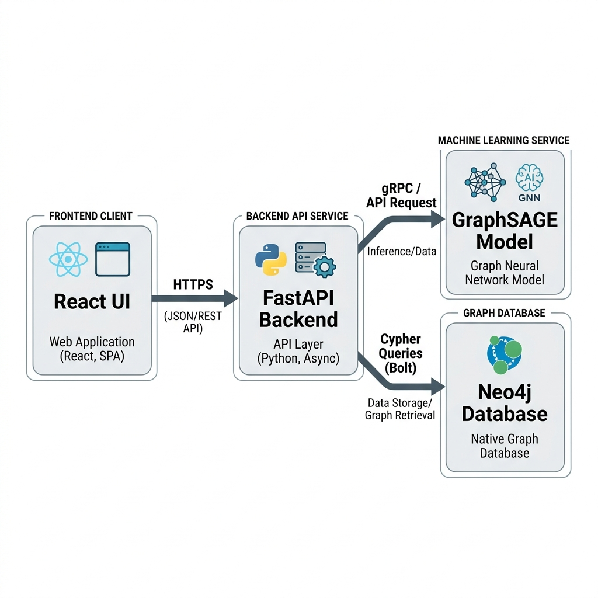

<div align="center">

# 🔍 Graph-Based Anti-Money Laundering (AML) Fraud Detection

### Using Cycle-Aware GraphSAGE with Structural Attention

[](https://www.python.org/)
[](https://pytorch.org/)
[](https://pyg.org/)
[](https://fastapi.tiangolo.com/)
[](LICENSE)

An end-to-end, scientifically defensible Graph Neural Network (GNN) framework for detecting complex money laundering topologies — cycles, scatter-gather, fan-in/fan-out, and stacks — on the IBM HI-Small synthetic transaction dataset (~4.9M edges).

<br>



</div>

---

## 📑 Table of Contents

- [Key Innovations](#-key-innovations--contributions)
- [Scientific Ablation Study](#-scientific-ablation-study)
- [Project Architecture](#-project-architecture)
- [Installation & Setup](#-installation--setup)
- [Dataset Setup](#-dataset-setup)
- [Usage Guide](#-usage-guide)
- [Web Dashboard](#-web-dashboard)
- [API Reference](#-api-reference)
- [Documentation](#-documentation)
- [Contributing](#-contributing)
- [License](#-license)
- [Citation](#-citation)

---

## 🌟 Key Innovations & Contributions

1.  **Zero Temporal Data Leakage:**
    - Strict chronological split: **Training** (Days 1–8), **Validation** (Day 9), **Testing** (Days 10–18).
    - Node aggregates and feature scaling are strictly fit *only* on training days.
    - Leakage-prone pre-computed labels (e.g. `laundering_rate`) are completely removed.

2.  **Phase 3A: N-Step Random Walk Cycle Feature Extractor:**
    - Computes 2-hop, 3-hop, 4-hop, and 5-hop return probabilities via sparse matrix powers with zero leakage.
    - Extracts discounted cumulative returns and topological cycle indicators across all 4.92M edges in seconds.

3.  **Phase 3B: Cycle-Aware Attention Layer (`CycleAwareSAGEConv`):**
    - Implements structural attention that re-weights neighbor message passing using edge cycle dynamics.
    - Prevents cyclical laundering signals from being diluted by vanilla GraphSAGE mean aggregation.

4.  **4-Level Ring Completeness Evaluation:**
    - **Alert Recall (≥1 edge):** Traditional operational detection.
    - **Majority Ring Recall (≥50%):** Majority of ring captured.
    - **Complete Ring Recall (100%):** Entire laundering syndicate completely dismantled.
    - **Mean Ring Edge Coverage:** Percentage of transactions identified per laundering pattern.

---

## 📊 Scientific Ablation Study

Evaluated on the held-out test window (Days 10–18, zero temporal leakage):

| Configuration | ROC-AUC | PR-AUC | Fraud Recall | Alert Recall (≥1) | Majority Ring (≥50%) | Complete Ring (100%) |
|---|:---:|:---:|:---:|:---:|:---:|:---:|
| **1. Vanilla GraphSAGE** | 0.9852 | 0.3235 | 87.4% | 98.7% | 97.8% | 76.9% |
| **2. + RW Cycle Features** | 0.9704 | 0.1113 | 75.3% | 96.1% | 92.6% | 63.8% |
| **3. + Cycle Attention (Full)** | **0.9889** | **0.5759** | **87.7%** | **98.7%** | **98.2%** | **85.2%** |

### 🔍 Key Insights

- **PR-AUC Leap (+78.0% Relative):** In extreme class imbalance (<0.1% fraud), PR-AUC jumped from **0.3235 → 0.5759**, slashing false positive alerts.
- **Complete Ring Dismantling (+8.3% Absolute):** Full ring dismantling rose from 76.9% → **85.2%** (36%+ reduction in escaped laundering rings).
- **Structural Attention is Essential:** Raw cycle features fed to standard mean aggregation (Config 2) dilute signal; dynamic attention aggregation (Config 3) preserves and amplifies cyclic message passing.

---

## 🏗️ Project Architecture

```
graph-based-fraud-detection-gnn-graphsage/
│
├── README.md                          # This file
├── LICENSE                            # MIT License
├── requirements.txt                   # Python dependencies
├── predict.py                         # Unified CLI for inference & ablation
│
├── src/                               # Core source code
│   ├── aml_pipeline/                  # Data & feature engineering
│   │   ├── aml_config.py              # Pipeline constants & hyperparameters
│   │   ├── preprocess.py              # Chronological preprocessing (leak-free)
│   │   ├── build_graph.py             # PyG graph construction
│   │   ├── cycle_features.py          # N-step random walk cycle extractor
│   │   ├── eda_cycles.py              # Cycle pattern EDA
│   │   ├── eda_general.py             # General exploratory data analysis
│   │   ├── smote_oversample.py        # SMOTE oversampling
│   │   ├── export_neo4j_aml.py        # Neo4j graph export
│   │   └── visualize_aml_graph.py     # Graph visualization utilities
│   ├── models/                        # GNN model definitions
│   │   ├── graphsage_model.py         # Vanilla GraphSAGE baseline
│   │   └── cycle_graphsage_model.py   # Cycle-Aware Attention GraphSAGE
│   ├── training/                      # Training & evaluation
│   │   ├── train_aml.py               # Baseline GraphSAGE trainer
│   │   ├── train_cycle_aml.py         # Cycle-Aware trainer (dynamic neg. sampling)
│   │   ├── evaluate_aml.py            # 4-level ring evaluation
│   │   └── evaluate_cycle_aml.py      # Unified ablation evaluator
│   └── api/
│       └── main.py                    # FastAPI backend (inference & ablation)
│
├── scripts/                           # Utility & helper scripts
│   ├── enrich_samples.py              # Enrich sample CSVs with neighborhood
│   ├── extract_subgraph.py            # Extract 2-hop subgraphs
│   ├── generate_graphs.py             # Graph generation utilities
│   └── run_aml_training.py            # Training runner script
│
├── data/
│   └── samples/                       # Sample transaction CSVs for testing
│       ├── sample_trans_4_with_fraud.csv
│       └── ...
│
├── docs/                              # Documentation
│   ├── ARCHITECTURE.md                # System architecture deep-dive
│   ├── SETUP.md                       # Detailed installation guide
│   ├── API_REFERENCE.md               # API endpoint documentation
│   ├── DATA_DICTIONARY.md             # Dataset schema & features
│   ├── METHODOLOGY_REPORT.md          # Research methodology
│   ├── PROGRESS_REPORT.md             # Development changelog
│   └── images/                        # Architecture diagrams & figures
│
└── website/                           # React interactive dashboard
    ├── src/
    │   ├── components/
    │   │   ├── Hero.jsx               # Landing hero section
    │   │   ├── TransactionAnalysis.jsx # Interactive GNN graph visualization
    │   │   ├── ResultsDashboard.jsx    # Model metrics dashboard
    │   │   ├── Methodology.jsx        # Methodology overview
    │   │   └── Insights.jsx           # Key insights display
    │   ├── App.jsx
    │   └── main.jsx
    └── package.json
```

---

## ⚡ Installation & Setup

### Prerequisites

- **Python** 3.10 or higher
- **Node.js** 18+ and **npm** (for the web dashboard)
- **Git**

### 1. Clone the Repository

```bash
git clone https://github.com/jaisimha18/graph-based-fraud-detection-gnn-graphsage.git
cd graph-based-fraud-detection-gnn-graphsage
```

### 2. Create Python Virtual Environment

```bash
python3 -m venv .venv
source .venv/bin/activate       # macOS / Linux
# .venv\Scripts\activate        # Windows
```

### 3. Install Python Dependencies

```bash
pip install -r requirements.txt
```

> **Note:** PyTorch and PyG wheel versions depend on your OS and CUDA version. See the [PyTorch installation guide](https://pytorch.org/get-started/locally/) and [PyG installation guide](https://pytorch-geometric.readthedocs.io/en/latest/install/installation.html) for platform-specific instructions.

### 4. Install Frontend Dependencies

```bash
cd website
npm install
cd ..
```

---

## 📦 Dataset Setup

This project uses the **IBM HI-Small Synthetic AML Transaction Dataset**. Due to its size (~454 MB), it is **not included** in the repository.

### Download Instructions

1. Download the dataset from the [IBM AML Dataset on Kaggle](https://www.kaggle.com/datasets/ealtman2019/ibm-transactions-for-anti-money-laundering-aml)
2. Extract the files into the `AML_DATASET/` directory:

```bash
mkdir -p AML_DATASET
# Place the following files inside:
# AML_DATASET/HI-Small_Trans.csv      (~454 MB — transaction records)
# AML_DATASET/HI-Small_accounts.csv   (~32 MB — account metadata)
```

3. The preprocessed graph files will be auto-generated under `outputs/` when you run the pipeline for the first time.

> See [docs/SETUP.md](docs/SETUP.md) for detailed dataset preparation instructions.

---

## 🚀 Usage Guide

### View Ablation Study

```bash
python predict.py --ablation
```

### View Model Evaluation Summary

```bash
# Cycle-Aware Attention Model (default)
python predict.py --summary --model cycle_attn

# Vanilla GraphSAGE Baseline
python predict.py --summary --model baseline
```

### Run Transaction Inference

```bash
# Run inference on sample CSV
python predict.py --csv data/samples/sample_trans_4_with_fraud.csv --model cycle_attn --limit 20

# Show only predicted fraudulent transactions
python predict.py --csv data/samples/sample_trans_4_with_fraud.csv --model cycle_attn --only-fraud
```

### Retrain Models

```bash
# Step 1: Extract cycle features (~7.5 seconds)
python -m src.aml_pipeline.cycle_features

# Step 2: Train Cycle-Aware Attention Model
python -m src.training.train_cycle_aml --mode cycle_attn --epochs 10 --neg_ratio 25

# Step 3: Evaluate all ablation variants
python -m src.training.evaluate_cycle_aml --eval all
```

---

## 🌐 Web Dashboard

The interactive dashboard provides real-time transaction analysis with force-graph visualization.

### Start the Application

```bash
# Terminal 1: Start FastAPI backend
uvicorn src.api.main:app --host 0.0.0.0 --port 8000 --reload

# Terminal 2: Start React frontend
cd website
npm run dev
```

Then open `http://localhost:5173` in your browser.

### Dashboard Features

- **Transaction Analysis:** Upload CSV files and visualize transaction networks as interactive force-directed graphs
- **GNN Inference:** Real-time fraud probability predictions per transaction
- **Results Dashboard:** View model performance metrics and ablation comparisons
- **Methodology:** Interactive overview of the Cycle-Aware GraphSAGE approach

---

## 📡 API Reference

The FastAPI backend exposes the following endpoints:

| Method | Endpoint | Description |
|---|---|---|
| `GET` | `/health` | Health check |
| `POST` | `/predict` | Run inference on uploaded transaction CSV |
| `GET` | `/ablation` | Get ablation study results |
| `GET` | `/summary/{model}` | Get evaluation summary for a specific model |

> See [docs/API_REFERENCE.md](docs/API_REFERENCE.md) for full endpoint documentation with request/response schemas.

---

## 📚 Documentation

| Document | Description |
|---|---|
| [ARCHITECTURE.md](docs/ARCHITECTURE.md) | System architecture, model design, and data flow |
| [SETUP.md](docs/SETUP.md) | Detailed installation and configuration guide |
| [API_REFERENCE.md](docs/API_REFERENCE.md) | REST API endpoint documentation |
| [DATA_DICTIONARY.md](docs/DATA_DICTIONARY.md) | Dataset schema, features, and preprocessing details |
| [METHODOLOGY_REPORT.md](docs/METHODOLOGY_REPORT.md) | Research methodology and experimental design |
| [PROGRESS_REPORT.md](docs/PROGRESS_REPORT.md) | Development timeline and engineering changelog |

---

## 🤝 Contributing

Contributions are welcome! Please see [CONTRIBUTING.md](CONTRIBUTING.md) for guidelines on:

- Setting up the development environment
- Code style and conventions
- Submitting pull requests
- Reporting issues

---

## 📜 License

This project is licensed under the MIT License — see the [LICENSE](LICENSE) file for details.

---

## 📖 Citation

If you use this work in your research, please cite:

```bibtex
@software{jaisimha2026cycleaware,
  title     = {Graph-Based Anti-Money Laundering Fraud Detection Using Cycle-Aware GraphSAGE},
  author    = {Jaisimha},
  year      = {2026},
  url       = {https://github.com/jaisimha18/graph-based-fraud-detection-gnn-graphsage},
  note      = {B.Tech CSE Final Year Project}
}
```

---

<div align="center">

**Built with** ❤️ **using PyTorch Geometric, FastAPI, and React**

</div>
